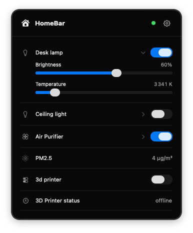

# HomeBar


A lightweight, native macOS menu bar dashboard for Home Assistant.



## Features

- Lightweight
- Customizable: select, reorder and rename entities
- Support for lights, fans, plugs, and sensors
- Secure token storage in Keychain
- Native UI


## Installation

Download the latest version from [releases](https://github.com/jeromeberg/homebar/releases/latest) page.

## Connect to Home Assistant 

1. Open Home Assistant and go to your profile → **Security**.
2. Under **Long-lived access tokens**, create a token and copy it (it will only be shown once).
3. Open HomeBar and enter your Home Assistant server URL.
4. Paste the token into Access Token and click Connect.

## Instructions

### Requirements

- macOS 14 (Sonoma) or later
- Xcode Command Line Tools (`xcode-select --install`)

### Build and run

```sh
# Build
./build.sh

# Run
open .build/HomeBar.app
```

### Tests

```sh
./test.sh
```

## Resources

- [Home Assistant WebSocket API](https://developers.home-assistant.io/docs/api/websocket/)
- [Home Assistant authentication API](https://developers.home-assistant.io/docs/auth_api/#long-lived-access-token)
