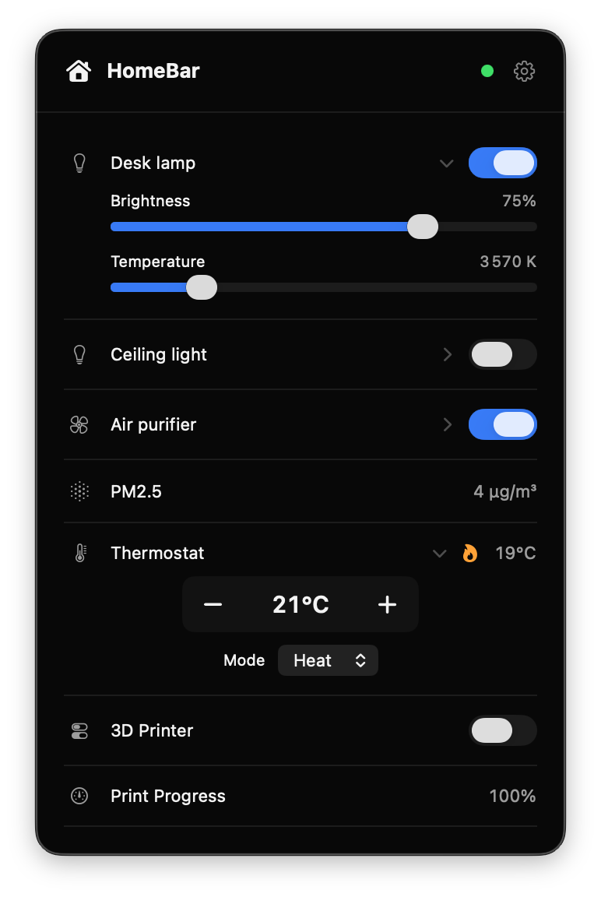

# HomeBar


A lightweight, native macOS menu bar dashboard for Home Assistant.



## Features

- Lightweight and minimal.
- **Customizable**: select, reorder, and rename entities.
- **Easy setup**: automatic server discovery and Home Assistant browser sign-in.
- Secure token storage in Keychain.
- Native UI.
- **Supported entities**: 
  - Lights (brightness, color temperature)
  - Fans (speed, presets)
  - Plugs and switches
  - Climate control (modes, presets, target temperature, heating/cooling indicators)
  - Sensors

## Installation

Download the latest version from [releases](https://github.com/jeromeberg/homebar/releases/latest) page.

**Installation:** Download the ZIP file, extract it, and move `HomeBar.app` to your Applications folder.

**Note**: HomeBar is not notarized by Apple, so macOS may block it on first launch.

To open HomeBar (only required once):

1. Try opening `HomeBar.app`.
2. Go to **System Settings → Privacy & Security**.
3. Scroll down to **Security** and click **Open Anyway**.
4. Confirm when prompted.

## Instructions

### Requirements

- macOS 14 (Sonoma) or later
- Xcode Command Line Tools (`xcode-select --install`)

### Build and run

```sh
# Build
./build.sh

# Run
open .build/HomeBar.app
```

### Tests

```sh
./test.sh
```

## Resources

- [Home Assistant WebSocket API](https://developers.home-assistant.io/docs/api/websocket/)
- [Home Assistant authentication API](https://contributors.home-assistant.io/core/internals/auth-api/)
